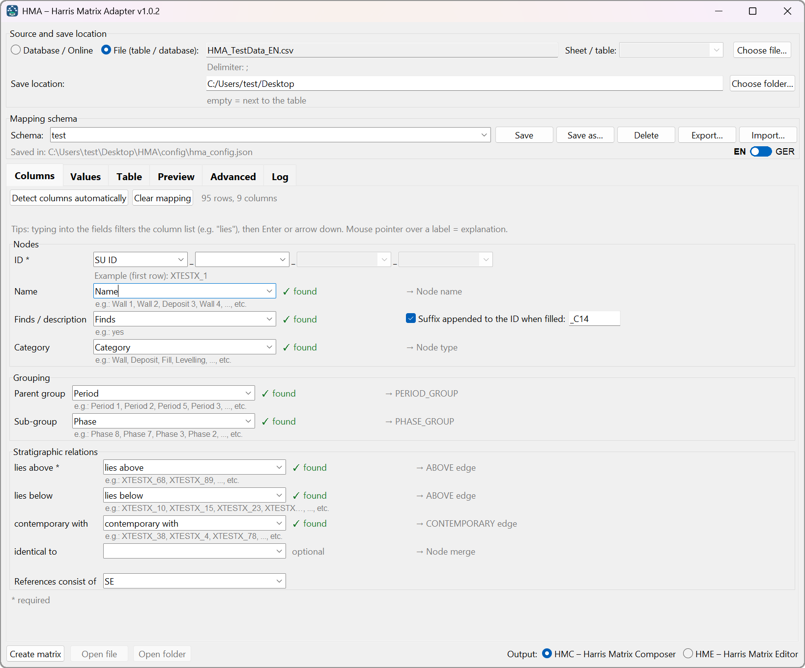
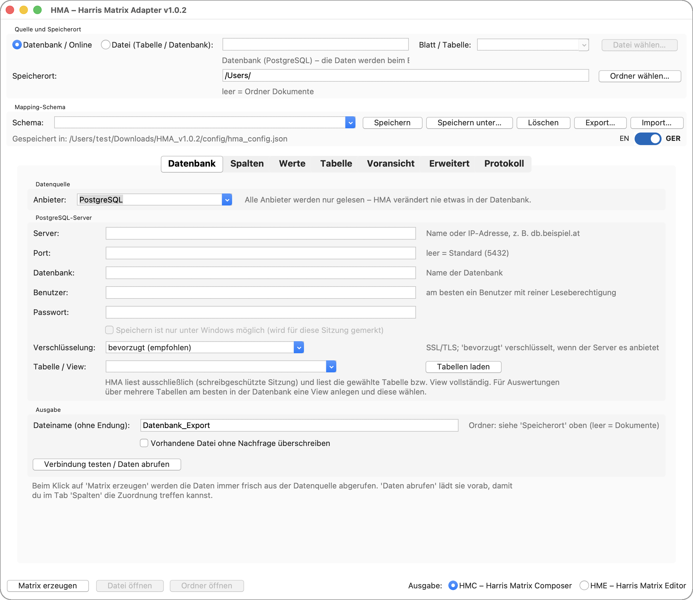
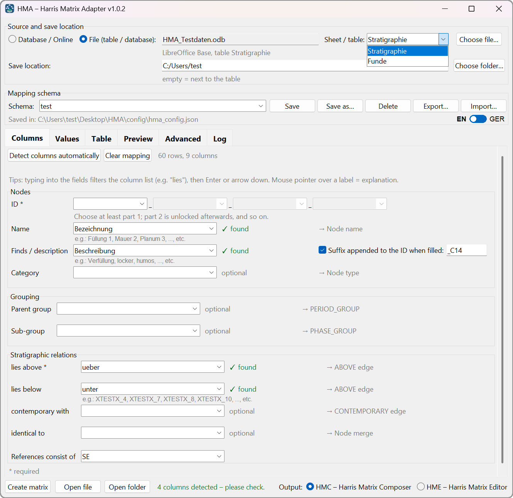
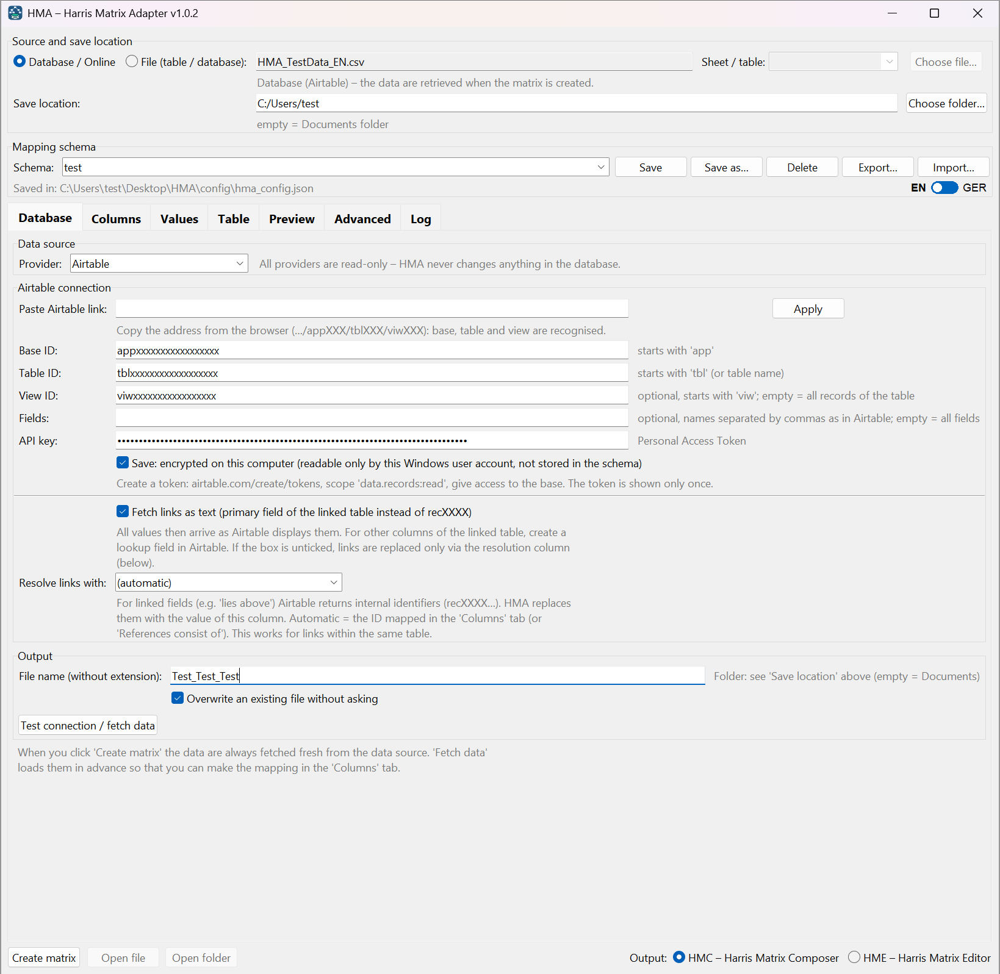
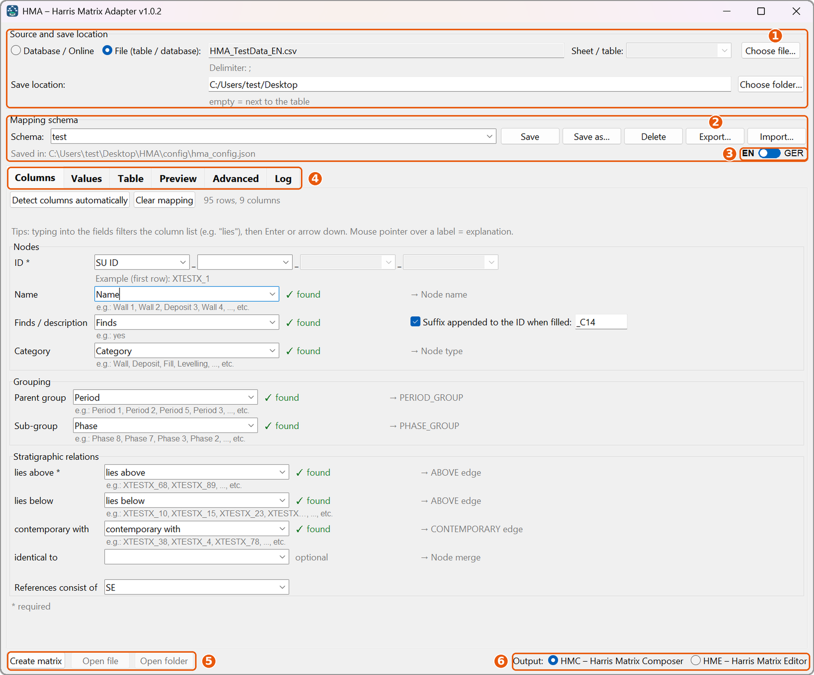
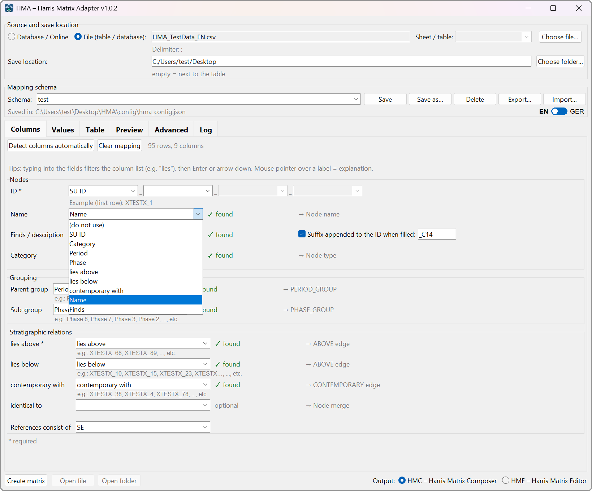
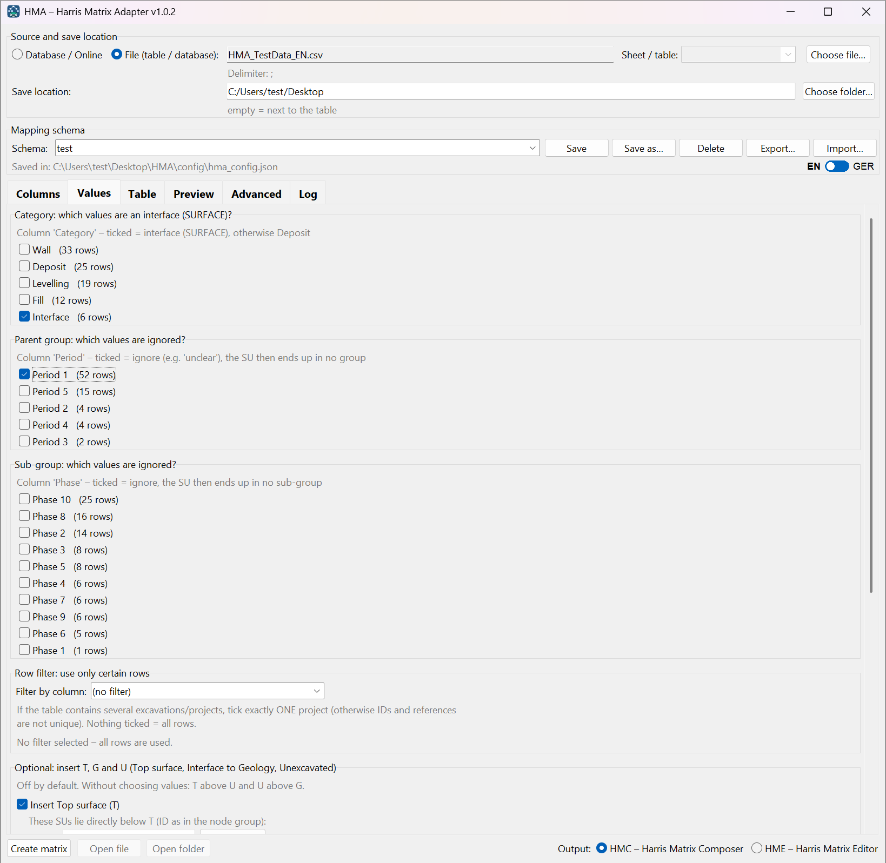
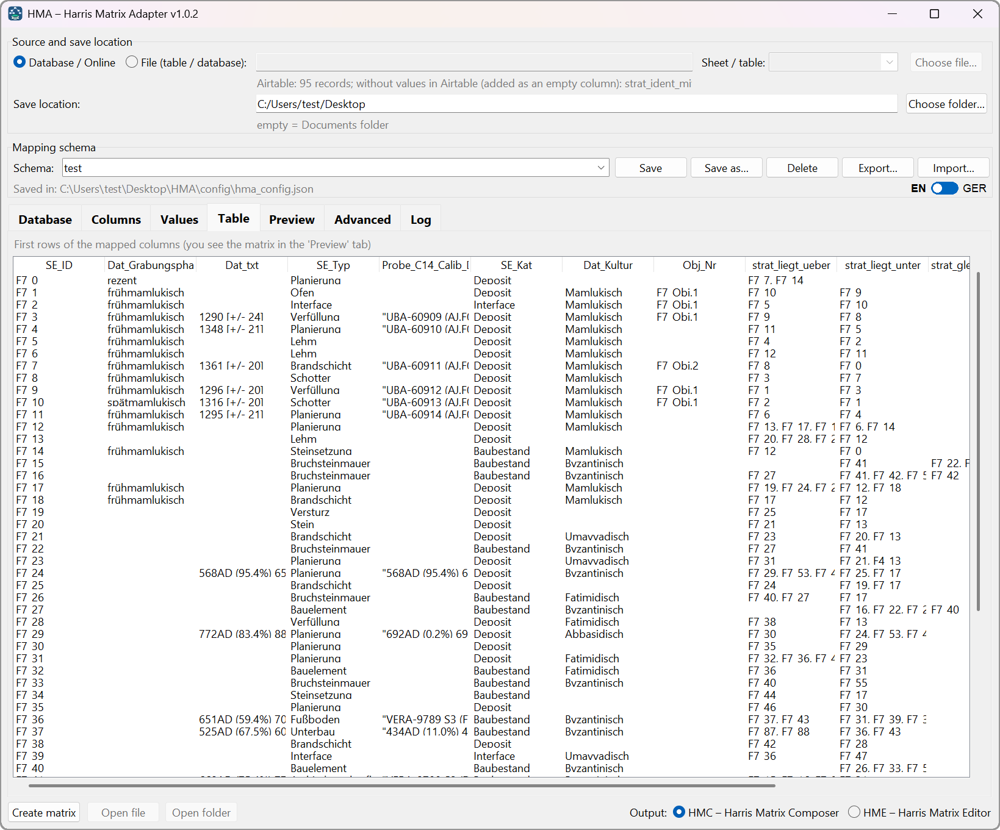
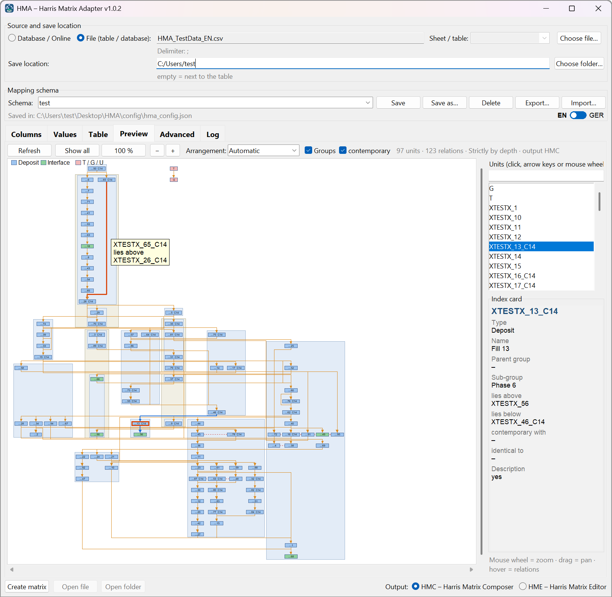
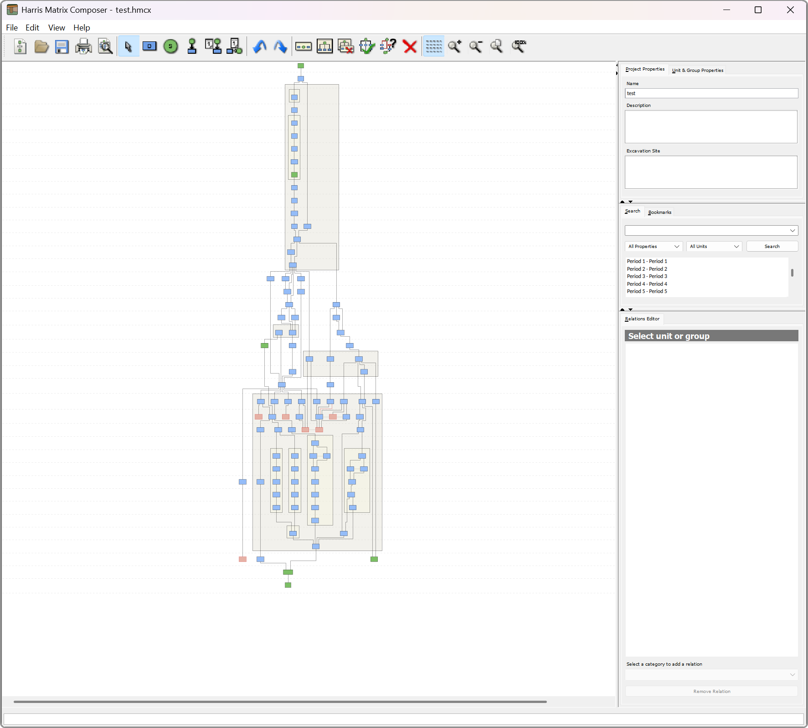

<p align="center"></p>

<h1 align="center">HMA – Harris Matrix Adapter</h1>

<p align="center"><em><a href="README.md">English version</a> · Deutsch</em></p>

<p align="center"></p>

## 1. Was ist HMA?

**HMA ist ein Adapter.** Er macht Grabungsdaten aus (Alt-)Datenbanken und Tabellen für Harris-Matrix-Programme
nutzbar. HMA liest deine Daten, ordnet die Spalten über ein einmal eingerichtetes *Mapping-Schema* ihren Aufgaben
zu und schreibt eine fertig zu öffnende Datei:

- eine `.hmcx`-Projektdatei für den **[Harris Matrix Composer (HMC)](http://www.harrismatrixcomposer.com)** oder
- eine `.json`-Datei für den **[Harris Matrix Editor (HME)](https://github.com/oeai-dac/HME-HarrisMatrixEditor)**.

```
 Grabungsdatenbank / Tabelle  ──►  HMA (Mapping-Schema)    ──►  .hmcx / .json  ──►  HMC / HME (Matrix ansehen)
```

**Was HMA nicht ist.** HMA ist kein Matrix-Editor und zeichnet die Matrix nicht. HMC und HME sind eigenständige
Projekte; für HMA dienen sie als *Betrachter* des Ergebnisses. Die eigentliche archäologische Matrix-Arbeit – die
Entscheidung, welche Einheit über welcher liegt – gehört dorthin, wo sie geschehen sollte: in die Grabungsdatenbank.
HMA liest nur. HMA **schreibt nie zurück** in eine Datenbank und ändert keine Quelldatei.

HMA ist freie Software (MIT-Lizenz), in reinem Python (nur Standardbibliothek) mit einem tkinter-Fenster geschrieben.

## 2. Installation und Start

Nötig ist **Python 3.10 oder neuer mit tkinter**. Sonst muss nichts installiert werden.

| System | Schritte |
|---|---|
| **Windows** | Python von [python.org](https://www.python.org/downloads/) installieren (Haken bei *Add python.exe to PATH*). `HMA.bat` doppelklicken. `Create_Shortcut.bat` legt eine Verknüpfung mit Symbol auf dem Desktop und im Startmenü an. |
| **macOS** | Python von [python.org](https://www.python.org/downloads/macos/) installieren (dieser Installer bringt Tk mit; das Python 3.9 der Apple-Entwicklerwerkzeuge ist zu alt). `HMA.command` doppelklicken. Beim ersten Start kann macOS blockieren: Rechtsklick → *Öffnen* → *Öffnen*, oder einmal im Terminal `xattr -dr com.apple.quarantine <HMA-Ordner>`. Alternative: `python3 script/HMA_v1.0.2.py`. **Zertifikate:** Python von python.org braucht für sichere Verbindungen (Airtable, Google Sheets) einmalig einen Zusatzschritt: Ordner *Programme → Python 3.x* öffnen und `Install Certificates.command` doppelklicken. Wurde das vergessen, greift HMA ersatzweise auf die Systemzertifikate zurück. |
| **Linux** | `python3 script/HMA_v1.0.2.py` (braucht das Paket mit tkinter, z. B. `python3-tk`). |

Ohne Fenster (nur Dateien):
`python script/HMA_v1.0.2.py --cli --schema "Name" [--out ORDNER] datei1.csv [datei2.xlsx ...]`

**Wo der Ordner liegen soll.** Lege den HMA-Ordner dorthin, wo du normale Schreibrechte hast, zum Beispiel auf den Desktop oder in *Dokumente*. Führe HMA **nicht** aus einem Ordner aus, der durch Administratorrechte oder ein Passwort geschützt ist (zum Beispiel `C:\Program Files`, `/Applications` oder andere Systemordner). HMA speichert deine Schemata in `config/` neben dem Skript; kann es dort nicht schreiben, weicht es unter Windows auf `%APPDATA%\HMA` aus (unter macOS und Linux auf `~/HMA`), was man leicht übersieht. Auch der *Speicherort* für die Ergebnisse muss beschreibbar sein.

**macOS.** Die macOS-Unterstützung ist neu und bisher nur kurz auf einem echten Mac getestet (Matrix-Dateien
erzeugen und Airtable-Daten abrufen haben funktioniert); bitte Probleme melden.

<p align="center"></p>
<p align="center"><em>HMA auf macOS (deutsche Oberfläche).</em></p>

**Sprache.** Fenster und Meldungen gibt es auf Deutsch und Englisch. Voreinstellung ist die Systemsprache; umschalten
mit dem Schalter **EN | GER** im Fenster (gilt ab dem nächsten Start), mit `--lang de|en` oder der
Umgebungsvariablen `HMA_LANG`. Die erzeugten Dateien hängen nicht von der Sprache ab. Die Auto-Erkennung der Spalten
kennt deutsche und englische Spaltennamen (z. B. `liegt über`, `zeitgleich mit`, `Kategorie`, `Periode`).

**Ordneraufbau**

```
HMA_v1.0.2/
├─ HMA.bat / HMA.command / Create_Shortcut.bat   Starter
├─ script/HMA_v1.0.2.py                          das Programm (eine einzige Datei)
├─ config/hma_config.json                        entsteht beim ersten Start: Schemata, letzter Stand, gemerkte Schlüssel
├─ icon/                                         Programmsymbol
├─ docs/screenshots/                             Screenshots für diese README
├─ testdata/                                     Beispieldaten (eine CSV) mit Anleitung
└─ README.md  README.de.md  LICENSE  THIRD_PARTY_NOTICES.md
```

## 3. Arbeiten mit dem HMA

### 3.1 Welche Daten nimmt HMA?

HMA liest **jeweils eine Tabelle**, und eine Tabelle beschreibt **eine Grabung** (eine Matrix). **Jede Zeile ist eine
stratigraphische Einheit (SE)**. Die stratigraphischen Beziehungen stehen in Spalten, deren Zellen die IDs anderer
Einheiten enthalten. Mehrere IDs in einer Zelle werden durch `,` oder `;` getrennt (im Reiter *Erweitert*
einstellbar); Anführungszeichen um einzelne IDs (`"A", "B"`) und eine Liste in eckigen Klammern
(`["A","B"]`) werden entfernt. Zum Ausprobieren liegt die Beispieltabelle `testdata/HMA_TestData_EN.csv` bei (englische Spaltennamen);
`testdata/README_TestData.txt` erklärt die Schritte.

### 3.2 Wie muss die Tabelle aussehen? Mindestspalten

| Nötig | Aufgabe im HMA | Beispiel |
|---|---|---|
| **Pflicht** | **ID** (bis zu vier Spalten werden mit `_` verbunden, z. B. Nummer + Typ + Datierung) | `125` oder `XTESTX_125` |
| **Pflicht** | **liegt über** – die Einheiten, auf denen diese Einheit liegt | `126, 127` |
| optional | **liegt unter** – Gegenrichtung; ergänzt Beziehungen | `120` |
| optional | **zeitgleich mit** – gleich alte Einheiten (werden als Zeitgleich-Beziehungen geschrieben) | `130` |
| optional | **ident mit** – identische Einheiten werden zu einem Knoten zusammengefasst (Anzeige `3=45`) | `45` |
| optional | **Name des Knotens** – Text im Knoten, z. B. der SE-Typ | `Mauer` |
| optional | **Funde / Beschreibung** – wird zur Beschreibung des Knotens (ein Suffix kennzeichnet Knoten mit Funden) | `Bruchsteine` |
| optional | **Kategorie** – im Reiter *Werte* legst du fest, welche Werte eine *Grenzfläche* (Interface) sind; alle anderen sind Ablagerungen | `Grenzfläche` |
| optional | **Übergeordnete / Untergeordnete Gruppe** – HMC: Periode → Phase; HME: Phase → Objekt | `Mittelalter` → `Bau 1` |
| optional | **Zeilenfilter** – nur bestimmte Zeilen verwenden, z. B. ein Projekt von mehreren in derselben Tabelle | `XTESTX` |

Die kleinstmögliche Tabelle (drei Beziehungen; `liegt über` nennt die älteren Einheiten):

| SE-ID | liegt über |
|---|---|
| 1 | 2, 3 |
| 2 | 4 |
| 3 | 4 |
| 4 | |

Regeln und typische Probleme (HMA meldet sie im Reiter *Protokoll* und erzeugt dann **keine** Datei, damit nichts
Falsches unbemerkt entsteht):

- IDs müssen eindeutig sein. SE-Nummern wiederholen sich von Grabung zu Grabung – enthält eine Tabelle mehrere
  Grabungen, mit dem **Zeilenfilter** (Reiter *Werte*) genau eine auswählen.
- Verweise müssen zur (zusammengesetzten) ID passen. Stehen in den Beziehungsspalten nur die SE-Nummern, während
  die ID aus mehreren Teilen besteht, die Spalte wählen, aus der die Verweise bestehen (Reiter *Spalten*, *Verweise
  bestehen aus*).
- Beziehungen auf eine nicht vorhandene ID werden gezählt und gemeldet.
- Kreise (A über B über A) sind Widersprüche in den Daten und werden gemeldet.
- Einheiten ohne jede Beziehung bleiben als einzelne Knoten erhalten.

### 3.3 Welche Formate liest HMA?

| Art | Formate | Hinweise |
|---|---|---|
| **Dateien** | CSV (Trennzeichen und Zeichensatz werden erkannt), Excel `.xlsx` `.xlsm` `.xls`, LibreOffice Calc `.ods`, dBase `.dbf` | passwortgeschützte Dateien sind nicht lesbar – als `.xlsx` oder `.csv` speichern |
| **Datenbank-Dateien** | SQLite (`.sqlite` `.db` `.gpkg`), LibreOffice Base `.odb`, Microsoft Access `.accdb` `.mdb` | Base: nur die eingebettete Datenbank (nicht eine Verknüpfung auf eine externe); Access: Windows mit der Access-Datenbank-Engine (mit Microsoft Office vorhanden) |
| **Online / Server** | Airtable, Google Sheets, PostgreSQL (z. B. Supabase), MySQL/MariaDB, FileMaker (Data API) | nur lesend; siehe 3.5 |

Ausgabe: `.hmcx` (HMC) oder `.json` (HME).

### 3.4 Lokale Daten mit mehreren Blättern oder Tabellen

Excel- und Calc-Mappen haben Blätter; Access-, Base- und SQLite-Dateien haben Tabellen. Nach **Datei wählen…** listet das
Feld **Blatt / Tabelle** sie auf. HMA liest **das gewählte Blatt** und zeigt es im Reiter *Tabelle*.

<p align="center"></p>
<p align="center"><em>Das Feld <b>Blatt / Tabelle</b> listet die Blätter bzw. Tabellen einer Datei auf (hier eine LibreOffice-Base-Datei).</em></p>

- Für Matrizen aus mehreren Blättern das nächste Blatt wählen und erneut *Matrix erzeugen* klicken. Hat die Datei mehr
  als ein Blatt, heißt das Ergebnis `<Datei>_<Blatt>` (z. B. `Mappe_Blatt2.hmcx`), nichts wird überschrieben.
- Hat jedes Blatt eigene Spalten, pro Aufbau ein Mapping-Schema speichern und zwischen den Schemata wechseln.
- Es können **mehrere Dateien** gleichzeitig gewählt werden; jede ergibt ein eigenes Ergebnis. Für alle gelten derselbe
  Blattname und dieselbe Zuordnung – das passt für Dateien mit gleichem Aufbau.
- Für Auswertungen über mehrere Tabellen in der Datenbank eine Sicht (View) oder Abfrage anlegen (oder ein
  zusammengeführtes Blatt) und diese wählen.

### 3.5 Datenbank-Anbindung

Oben **Datenbank / Online** wählen, dann im Reiter *Datenbank* den *Anbieter* wählen, die Verbindungsdaten eintragen
und **Verbindung testen / Daten abrufen** drücken. Danach im Reiter *Spalten* zuordnen. Beim Klick auf *Matrix erzeugen*
werden die Daten immer frisch aus der Quelle geholt.

<p align="center"></p>
<p align="center"><em>Reiter <b>Datenbank</b> mit dem Anbieter Airtable.</em></p>

- **Airtable.** Unter `airtable.com/create/tokens` einen *Personal Access Token* mit dem Recht `data.records:read` und
  Zugriff auf deine Base anlegen. Die Adresse der Tabelle aus dem Browser kopieren (`…/appXXX/tblXXX/viwXXX`), bei
  *Airtable-Link einfügen* einsetzen und *Übernehmen* klicken: Base, Tabelle und View werden ausgefüllt. *Verknüpfungen als
  Text abrufen* angehakt lassen, damit verknüpfte Felder wie `liegt über` als lesbare IDs statt als `recXXXX` ankommen.
- **Google Sheets.** Die Tabelle über *Jeder, der den Link hat → Betrachter* freigeben (oder im Web veröffentlichen), die
  Adresse aus dem Browser kopieren und einfügen. Mit `#gid=…` in der Adresse wird genau dieses Blatt gelesen, sonst das
  erste. Ein solcher Link ist öffentlich – nicht für sensible Daten verwenden; private Tabellen als `.xlsx` oder `.csv`
  herunterladen.
- **PostgreSQL** (auch Supabase) und **MySQL/MariaDB.** Server, Port, Datenbank, Benutzer und Passwort eintragen,
  *Tabellen laden* klicken und Tabelle oder View wählen. Die Sitzung ist schreibgeschützt. Für Supabase die
  Verbindungsdaten aus den Verbindungseinstellungen des Projekts nehmen; SSL-Modus *erforderlich* wird empfohlen. Am
  besten ein Benutzer mit nur lesenden Rechten.
- **FileMaker.** FileMaker Server mit aktivierter Data API und ein Konto mit dem Zugriffsrecht `fmrest`. Lokale
  `.fmp12`-Dateien können nicht direkt gelesen werden – die Tabelle als CSV oder Excel exportieren.
- **Schlüssel und Passwörter** stehen nie im Schema. Unter Windows können sie verschlüsselt gespeichert werden (an dein
  Benutzerkonto gebunden); unter macOS und Linux werden sie nur für die Sitzung gemerkt.

### 3.6 Mapping-Schemata – was sie tun

Jede Datenbank und jede Tabelle nennt ihre Spalten anders; HMA rät deshalb nicht, welche Spalte was bedeutet. Ein
**Mapping-Schema** ist die gespeicherte Anleitung, mit der HMA *deine* Art von Tabelle liest. Du richtest es einmal ein,
gibst ihm einen Namen – danach erledigt es die Arbeit. Es speichert:

- **Die Rollen der Spalten** – welche Spalte die ID ist, welche *liegt über*, *liegt unter*, *zeitgleich mit*, die
  Gruppen, den Fundtext, die Kategorie und den Zeilenfilter enthält (Reiter *Spalten*).
- **Die Regeln für die Werte** – welche Kategoriewerte Grenzflächen sind (und welcher HME-Typ aus den übrigen wird),
  welche Perioden-/Phasenwerte ignoriert werden, welche Zeilen verwendet werden, optionale T/G/U-Knoten (Reiter *Werte*).
- **Einlese-Details** – Trennzeichen, Textkodierung, das Trennzeichen zwischen Verweisen, das Entfernen eines
  ID-Präfixes, die HME-Option für undatierte Units (Reiter *Erweitert*).
- **Quelle und Ausgabe** – die Datei und das Blatt/die Tabelle oder die Datenbank-Verbindung (Anbieter, Server,
  Base/Tabelle/Ansicht, Benutzername – nie Schlüssel oder Passwörter), den Speicherort und das Ausgabeformat HMC oder HME.

Was dir das bringt:

- Für die nächste Datei mit demselben Aufbau – oder die nächste Grabungssaison – wählst du das Schema, klickst auf
  *Matrix erzeugen* und bist fertig; es muss nichts neu zugeordnet werden.
- Du kannst **ein Schema pro Art von Tabelle** führen (zum Beispiel eines für deine Airtable-Base und eines für eine
  alte Access-Datei) und zwischen ihnen wechseln.
- Schemata lassen sich in eine `.json`-Datei **exportieren** und von Kolleginnen und Kollegen **importieren**, sodass
  alle die Daten auf dieselbe Weise lesen (was ein Export enthält: siehe ② in Abschnitt 4).
- Dasselbe Schema funktioniert **ohne Fenster**: `--schema "Name"` in der Kommandozeilen-Version wandelt viele Dateien
  in einem Zug um.
- Ein Schema beschreibt nur, wie Daten *gelesen* werden. Es verändert nie deine Quelldaten. Schemata liegen in
  `config/hma_config.json` (diese Datei nicht weitergeben – sie enthält auch deine gemerkten Schlüssel); der zuletzt
  verwendete Stand wird beim nächsten Start automatisch wiederhergestellt.

## 4. Das Fenster

<p align="center"></p>
<p align="center"><em>Die Nummern ①–⑥ beziehen sich auf die Beschreibung unten.</em></p>

**① Oben – Quelle und Speicherort.** Umschalten zwischen *Datenbank / Online* und *Datei (Tabelle / Datenbank)*. Bei
Dateien: *Datei wählen…* und *Blatt / Tabelle* für Mappen und Datenbank-Dateien. *Speicherort* ist der Ordner für das
Ergebnis (leer = neben der Tabelle; im Datenbank-Modus der Ordner *Dokumente*).

**② Mapping-Schema.** Ein Schema speichert die Zuordnung der Spalten und alle Einstellungen unter einem Namen (was das bedeutet: siehe 3.6):
*Speichern*, *Speichern unter…*, *Löschen*, *Export…* und *Import…* (eine `.json`-Datei zum Weitergeben an
Kolleginnen und Kollegen). Der zuletzt verwendete Stand wird automatisch gemerkt. Der Schalter **EN | GER** (③) stellt die
Sprache ein. Exportierte Schemata enthalten Verbindungsdaten (Server, Base-/Tabellen-ID, Benutzername,
Google-Sheets-Link), aber nie Schlüssel oder Passwörter – nur an Personen weitergeben, die auf die Daten zugreifen
dürfen.

**④ Die Reiter**

| Reiter | Was du dort tust |
|---|---|
| **Datenbank** | Nur im Modus *Datenbank / Online* sichtbar: Anbieter, Verbindungsdaten, Schlüssel, Name der Ausgabedatei, *Vorhandene Datei ohne Nachfrage überschreiben*, *Verbindung testen / Daten abrufen*. |
| **Spalten** | Spalten den Aufgaben aus 3.2 zuordnen. *Spalten automatisch erkennen* schlägt eine Zuordnung vor; *Zuordnung leeren* beginnt von vorn. Tippen in ein Feld filtert die Spaltenliste; unter jedem Feld stehen Beispielwerte. |
| **Werte** | Welche Kategoriewerte Grenzflächen sind; welche Perioden-/Gruppenwerte ignoriert werden (z. B. „unklar“); der Zeilenfilter (eine Grabung pro Matrix); optional T/G/U-Knoten (Oberfläche, Grenzfläche zum Anstehenden, Unausgegrabenes). |
| **Tabelle** | Die ersten Zeilen der zugeordneten Spalten – eine schnelle Kontrolle, ob die richtigen Spalten gelesen werden. |
| **Voransicht** | Ein schneller Blick auf das Ergebnis vor dem Erzeugen – siehe unten. |
| **Erweitert** | CSV-Trennzeichen, Zeichensatz, Entfernen eines ID-Präfixes (regulärer Ausdruck), Trenner zwischen Verweisen, HME-Option für Einheiten ohne Periode. |
| **Protokoll** | Der Bericht jedes Laufs: Zahlen, Warnungen und – bei logischen Fehlern in den Daten – die genauen Zeilen samt Lösungsvorschlag. *Protokoll speichern…*, *Kopieren*, *Leeren*. |

<p align="center"></p>
<p align="center"><em>Reiter <b>Spalten</b> – die Liste zeigt die Spalten der Tabelle; Tippen filtert sie.</em></p>
<p align="center"></p>
<p align="center"><em>Reiter <b>Werte</b> – Grenzflächen, ignorierte Perioden-/Phasenwerte, Zeilenfilter, optional T, G und U.</em></p>

<p align="center"></p>
<p align="center"><em>Reiter <b>Tabelle</b> – die ersten Zeilen der zugeordneten Spalten, um zu prüfen, ob die richtigen Spalten gelesen werden.</em></p>

**Zur Voransicht.** Der Reiter *Voransicht* ist eine **Oberfläche zur schnellen Durchsicht deiner Daten**: die Einheiten
in ihren Gruppen, ihre Beziehungen (Mauszeiger über eine Einheit), Zeitgleich-Beziehungen, eine durchsuchbare ID-Liste
und eine *Karteikarte* mit allen Werten der gewählten Einheit. Sie dient dazu, Datenprobleme früh zu erkennen (fehlende
Beziehungen, widersprüchliche Datierung). Sie ist **nicht** die Matrix-Darstellung: Die Anordnung ist nur eine
Näherung. Die eigentliche Matrix-Darstellung übernehmen HMC und HME. Deshalb gibt es bewusst keinen Export aus der
Voransicht.

*Bewegen:* Mit der Maus ziehen verschiebt das Bild. Unter Windows und Linux zoomt das Mausrad; auf dem Mac verschieben Zwei-Finger-Scrollen (Trackpad) bzw. das Rad das Bild, mit ⌘ + Scrollen wird gezoomt. Die Tasten **−**, **+**, *100 %* und *Alles anzeigen* funktionieren überall.

<p align="center"></p>
<p align="center"><em>Reiter <b>Voransicht</b> – die Einheiten in ihren Gruppen, eine durchsuchbare ID-Liste und die Karteikarte der gewählten Einheit.</em></p>

**Unten.** ⑤ *Matrix erzeugen*, *Datei öffnen*, *Ordner öffnen* und die Statuszeile; ⑥ die Wahl der **Ausgabe**: HMC oder HME.

## 5. Matrix erzeugen

1. Quelle und ggf. Blatt/Tabelle wählen. Spalten zuordnen (*Spalten*), Werte festlegen (*Werte*).
2. Reiter *Tabelle* und *Voransicht* prüfen.
3. Unten rechts die Ausgabe wählen: **HMC** (`.hmcx`) oder **HME** (`.json`).
4. **Matrix erzeugen** klicken. Der Reiter *Protokoll* öffnet sich: grün *keine Fehler* oder eine Liste der Probleme.
   *Datei öffnen* und *Ordner öffnen* zeigen das Ergebnis. Eine `.hmcx` öffnet sich in HMC; eine `.json` wird in HME
   mit dessen Import-Funktion geladen.

<p align="center"></p>
<p align="center"><em>Das Ergebnis von Schritt 4: eine <code>.hmcx</code>-Datei, geöffnet im Harris Matrix Composer (HMC). HMC ist ein eigenes Programm; HMA bereitet nur die Datei vor. Namen im Screenshot sind anonymisiert.</em></p>

**Tipp: die Matrix im HMC offen lassen (Windows).** HMC muss nicht geschlossen werden, wenn du Daten änderst und eine
neue Matrix willst. Lass die Datei in HMC offen, korrigiere die Datensätze in deiner Datenbank und klicke erneut auf
*Matrix erzeugen* mit demselben Dateinamen. HMA erkennt, dass die Datei in HMC geöffnet ist, und fragt nach; bei *Ja*
schließt es das HMC-Fenster **ohne zu speichern**, schreibt die neue Datei und öffnet sie an derselben Stelle und in
derselben Größe wieder. So korrigierst du in der Datenbank und siehst die Matrix nach wenigen Sekunden neu. Wegen
„ohne zu speichern“ in einer solchen Datei keine manuellen Änderungen in HMC machen – HMC ist der Betrachter, die
Datenarbeit bleibt in der Datenbank.

## 6. Hinweise zur Verwendung

- **Ergebnisse prüfen.** Die erzeugte Matrix ersetzt keine fachliche Prüfung. Vor Auswertung oder Veröffentlichung
  Zeilenzahlen und Beziehungen mit der Quelle vergleichen.
- **Verschlüsselte Verbindung.** Bei PostgreSQL und MySQL/MariaDB ist *bevorzugt* voreingestellt und fällt nötigenfalls
  auf eine unverschlüsselte Verbindung zurück. Bei personenbezogenen oder sensiblen Daten *erforderlich* wählen.
- **Fundorte und personenbezogene Daten.** Enthalten die Tabellen Fundstellen-Koordinaten, Namen oder andere
  geschützte Angaben, gelten die Regeln deiner Behörde und das Datenschutzrecht, besonders bei Cloud-Diensten.
- Die Datei `config/hma_config.json` enthält deine Schemata und die verschlüsselten Schlüssel; nicht weitergeben.

## 7. Verhältnis zu anderen Programmen

HMA steht in keiner Verbindung zu den Herstellern von Harris Matrix Composer (HMC), Harris Matrix Editor (HME),
Airtable, FileMaker/Claris, Microsoft Access, Google, Supabase, PostgreSQL oder MySQL. Alle Namen gehören ihren
Inhabern und werden hier nur genannt, um die Kompatibilität zu beschreiben.

- **HMC:** HMA schreibt Dateien im `.hmcx`-Format von HMC (ein ZIP-Archiv mit `matrix.xml` und `project.xml`). HMA enthält
  keinen Programmcode von HMC, verändert HMC nicht und umgeht keine Beschränkungen. Für die Nutzung von HMC gelten dessen
  eigene Lizenzbedingungen; bitte lies sie, besonders zu den Grenzen der kostenlosen Version.
- **HME:** HMA schreibt `.json`-Dateien, die HME lesen kann. Die Positionen der Units in dieser Datei werden mit einem
  Nachbau des *Auto-Layouts* von HME berechnet (`hme_layout()` im Skript), damit die Matrix im HME so aussieht, als hätte
  HME sie selbst angeordnet. **HME – Harris Matrix Editor**, Copyright (c) 2026 oeai-dac, ist freie Software unter der
  **MIT-Lizenz** (<https://github.com/oeai-dac/HME-HarrisMatrixEditor>). Sein Urheberrechts- und Lizenzhinweis steht in
  `THIRD_PARTY_NOTICES.md` und im Skript. HME ist ein eigenes Projekt; HMA steht in keiner Verbindung zu ihm.

## 8. Teststand

Gegen echte Dienste getestet: Airtable, Google Sheets, PostgreSQL (Supabase und
ein lokaler PostgreSQL-16-Server). Alle Dateiformate sind getestet. MySQL/MariaDB und FileMaker bisher nur gegen
Nachbauten. Kurz auf einem Mac getestet: Matrix-Dateien erzeugen und Airtable-Daten abrufen. Noch nicht getestet: Access mit einer
echten Datei, `.odb` in LibreOffice selbst und unter macOS die endgültige Bedienung der Voransicht, der
Zertifikats-Fallback und das Öffnen des Ergebnisses in HMC. Fehlermeldungen sind willkommen.

## 9. Lizenz

MIT, siehe `LICENSE`. Die Software wird „wie besehen“ ohne jede Gewährleistung bereitgestellt. Hinweise zu Material Dritter (HME, MIT): `THIRD_PARTY_NOTICES.md`.
