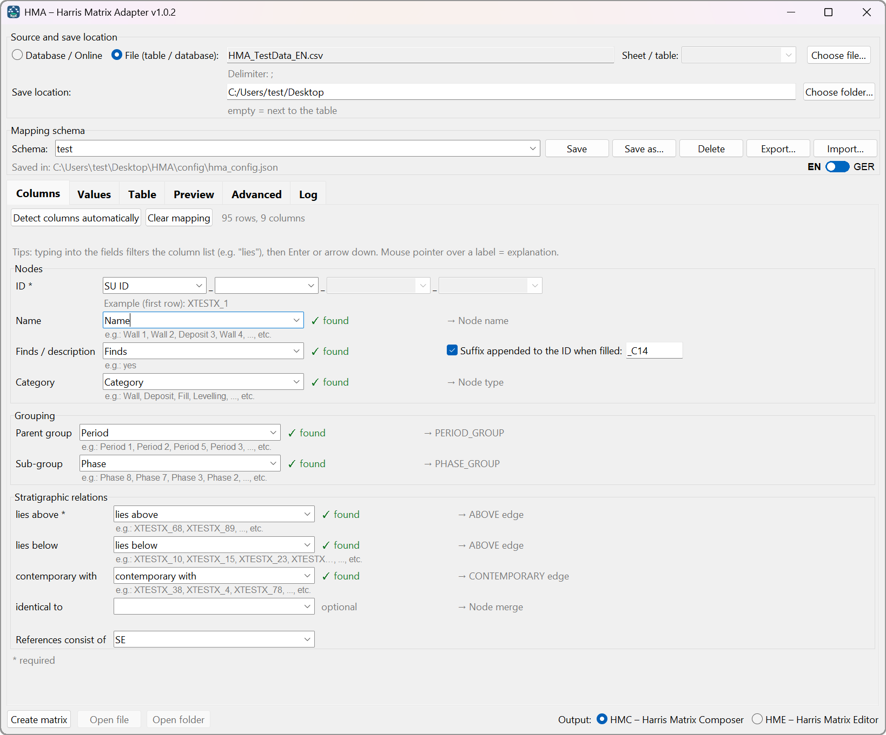
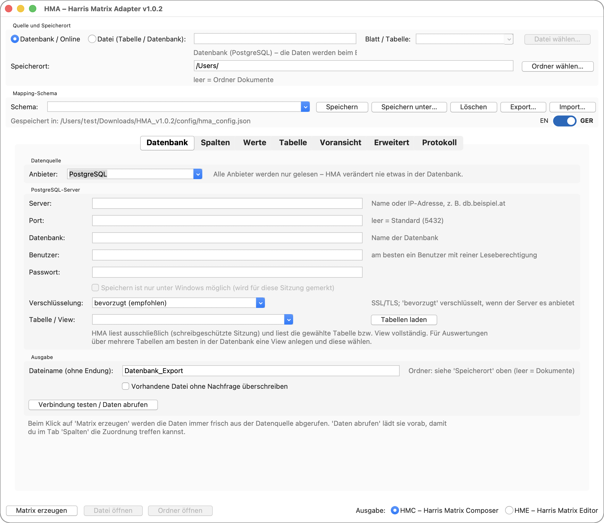
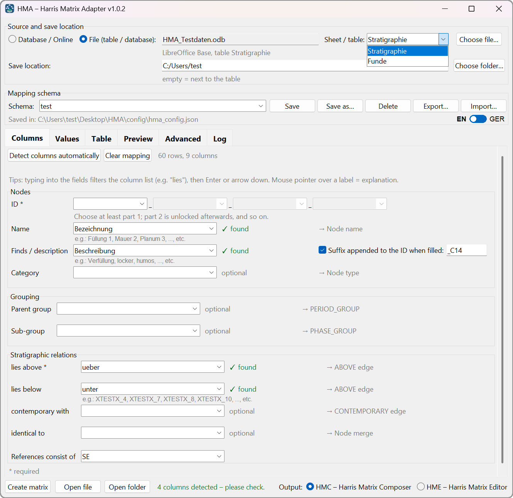
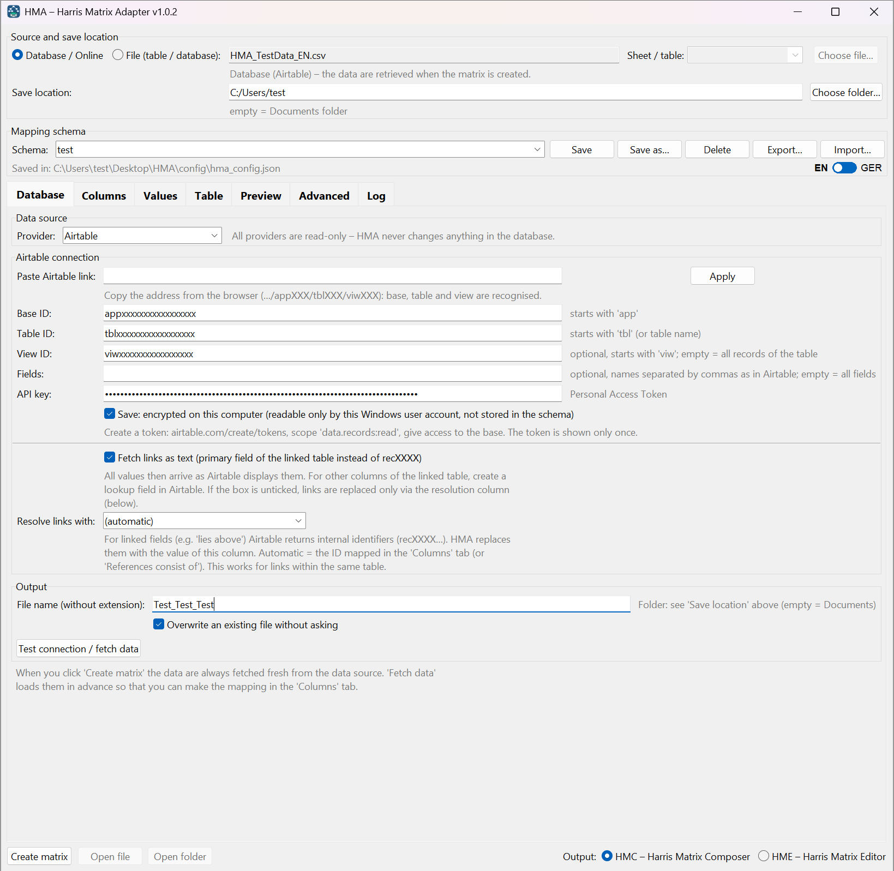
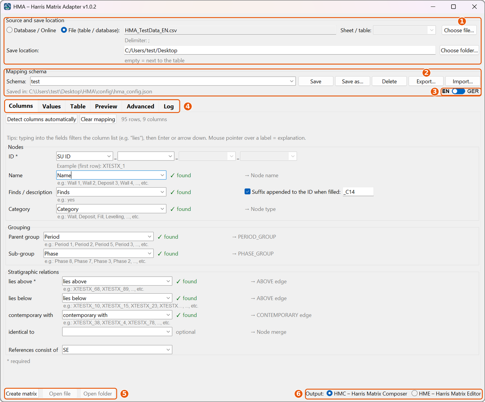
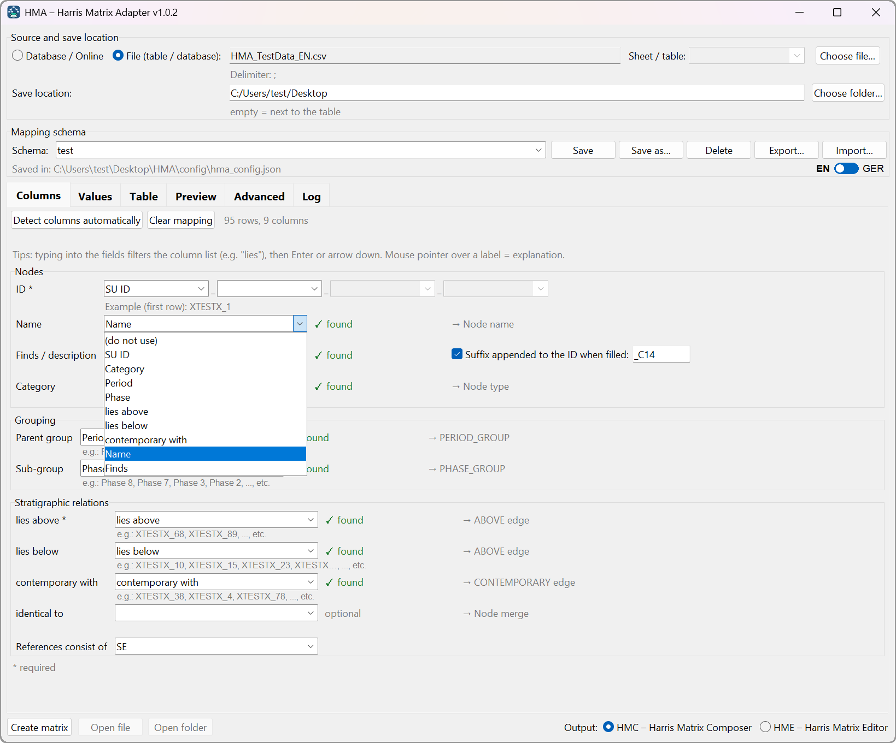
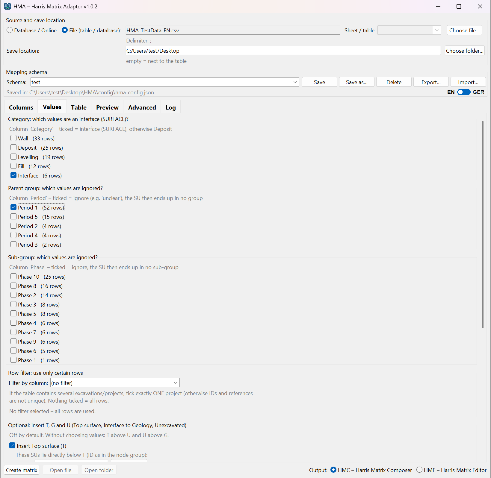
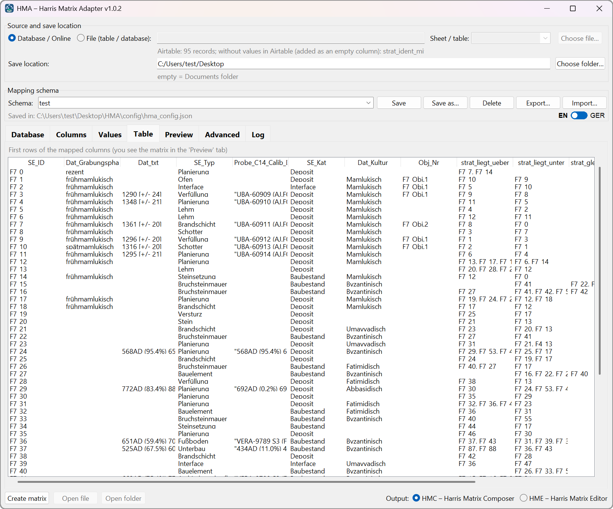
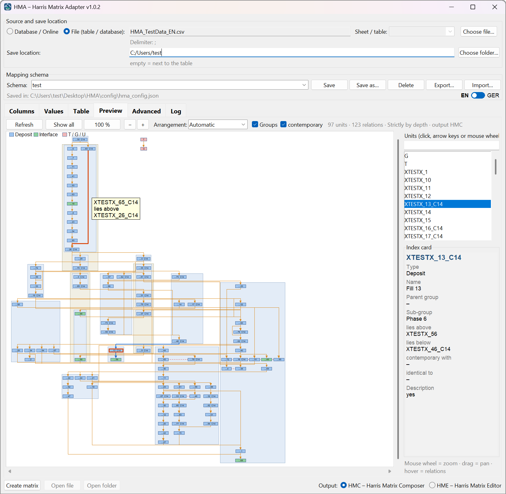
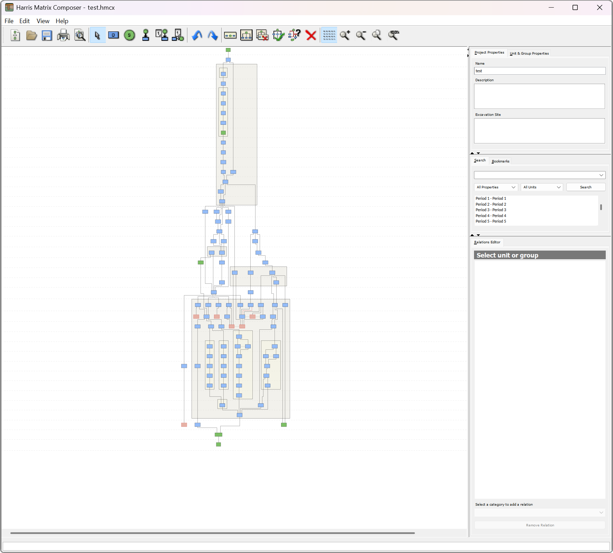

<p align="center"></p>

<h1 align="center">HMA – Harris Matrix Adapter</h1>

<p align="center"><em>English · <a href="README.de.md">Deutsche Version</a></em></p>

<p align="center"></p>

## 1. About HMA

**HMA is an adapter.** It makes excavation data from (legacy) databases and tables usable for Harris matrix
programs. It reads your data, assigns the columns to their roles through a *mapping schema* that you set up once, and
writes a ready-to-open file:

- an `.hmcx` project file for the **[Harris Matrix Composer (HMC)](https://hmc.archpro.science/)**, or
- a `.json` file for the **[Harris Matrix Editor (HME)](https://github.com/oeai-dac/HME-HarrisMatrixEditor)**.

```
 excavation database / table  ──►  HMA (mapping schema)  ──►  .hmcx / .json  ──►  HMC / HME (view the matrix)
```

**What HMA is not.** HMA is not a matrix editor and does not draw the matrix. HMC and HME are independent projects;
for HMA they act as *viewers* of the result. The real archaeological matrix work – deciding which unit lies above
which – belongs where it should happen: in the excavation database. HMA only reads. It **never writes back** to a
database or changes your source files.

HMA is free software (MIT licence), written in pure Python (standard library only) with a tkinter window.

## 2. Installation and start

You need **Python 3.10 or newer with tkinter**. Nothing else has to be installed.

| System | Steps |
|---|---|
| **Windows** | Install Python from [python.org](https://www.python.org/downloads/) (tick *Add python.exe to PATH*). Double-click `HMA.bat`. `Create_Shortcut.bat` adds a shortcut with icon to the desktop and the Start menu. |
| **macOS** | Install Python from [python.org](https://www.python.org/downloads/macos/) (this installer includes Tk; the Python 3.9 of Apple's developer tools is too old). Double-click `HMA.command`. At the first start macOS may block it: right-click → *Open* → *Open*, or run `xattr -dr com.apple.quarantine <HMA folder>` once in the Terminal. Alternative: `python3 script/HMA_v1.0.2.py`. **Certificates:** python.org Python needs a one-time step for secure connections (Airtable, Google Sheets): open the folder *Applications → Python 3.x* and double-click `Install Certificates.command`. HMA also falls back to the system certificates if this step was skipped. |
| **Linux** | `python3 script/HMA_v1.0.2.py` (needs the package that provides tkinter, e.g. `python3-tk`). |

Without the window (files only):
`python script/HMA_v1.0.2.py --cli --schema "Name" [--out FOLDER] file1.csv [file2.xlsx ...]`

**Where to put the folder.** Keep the HMA folder where you have normal write permission, for example on the Desktop or in *Documents*. Do **not** run HMA from a folder that is protected by administrator rights or a password (for example `C:\Program Files`, `/Applications` or other system folders). HMA saves your schemas in `config/` next to the script; if it cannot write there, it falls back to `%APPDATA%\HMA` on Windows (`~/HMA` on macOS and Linux), which is easy to overlook. The *save location* for the results must be writable, too.

**macOS.** macOS support is new and has so far only been tested briefly on a real Mac (creating matrix files and
retrieving Airtable data worked); please report problems.

<p align="center"></p>
<p align="center"><em>HMA on macOS (German interface).</em></p>

**Language.** The window and all messages exist in English and German. The default is the system language;
change it with the **EN | GER** switch in the window (takes effect at the next start), with `--lang de|en`, or with the
environment variable `HMA_LANG`. The generated files do not depend on the language. Column auto-detection
recognises German and English column names (e.g. `lies above`, `contemporary with`, `Category`, `Period`).

**Folder layout**

```
HMA_v1.0.2/
├─ HMA.bat / HMA.command / Create_Shortcut.bat   launchers
├─ script/HMA_v1.0.2.py                          the program (a single file)
├─ config/hma_config.json                        created at the first start: schemas, last state, saved keys
├─ icon/                                         program icon
├─ docs/screenshots/                             screenshots used in this README
├─ testdata/                                     sample data (one CSV) with instructions
└─ README.md  README.de.md  LICENSE  THIRD_PARTY_NOTICES.md
```

## 3. Working with HMA

### 3.1 Which data does HMA use?

HMA reads **one table at a time**, and one table describes **one excavation** (one matrix). **Each row is one
stratigraphic unit (SU)**. The stratigraphic relations are columns whose cells contain the IDs of other units. Several
IDs in one cell are separated by `,` or `;` (adjustable in the *Advanced* tab); quotation marks around single IDs (`"A", "B"`) and a list in brackets
(`["A","B"]`) are removed. To try HMA out, use the sample table
`testdata/HMA_TestData_EN.csv`; `testdata/README_TestData.txt` explains the steps.

### 3.2 What must the table look like? Minimum columns

| Needed | Role in HMA | Example |
|---|---|---|
| **required** | **ID** (up to four columns are joined with `_`, e.g. number + type + dating) | `125` or `XTESTX_125` |
| **required** | **lies above** – the units this unit lies on top of | `126, 127` |
| optional | **lies below** – reverse direction; adds relations | `120` |
| optional | **contemporary with** – units of the same age (written as contemporary relations) | `130` |
| optional | **identical to** – identical units are merged into one node (shown as `3=45`) | `45` |
| optional | **Node name** – text shown in the node, e.g. the unit type | `Wall` |
| optional | **Finds / description** – becomes the node description (a suffix marks nodes that have finds) | `Rubble stone` |
| optional | **Category** – you decide in the *Values* tab which values are an *interface* (surface); all others are deposits | `Interface` |
| optional | **Parent group**, **Sub-group** – HMC: period → phase; HME: phase → object | `Medieval` → `Building 1` |
| optional | **Row filter** – use only some rows, e.g. one project of several in the same table | `XTESTX` |

The smallest possible table (here three relations, `lies above` lists the older units):

| SU ID | lies above |
|---|---|
| 1 | 2, 3 |
| 2 | 4 |
| 3 | 4 |
| 4 | |

Rules and typical problems (HMA reports them in the *Log* tab and then creates **no** file, so nothing wrong is
produced silently):

- IDs must be unique. SU numbers repeat from excavation to excavation – if one table holds several excavations, use
  the **row filter** (*Values* tab) to keep exactly one.
- References must match the (composed) ID. If the relation columns only hold the SU number while the ID is composed
  of several parts, choose the column that the references consist of (*Columns* tab, *References consist of*).
- Relations that point to an ID that does not exist are counted and reported.
- Cycles (A above B above A) are contradictions in the data and are reported.
- Units without any relation are kept as isolated nodes.

### 3.3 Which formats can HMA read?

| Kind | Formats | Notes |
|---|---|---|
| **Files** | CSV (delimiter and encoding detected automatically), Excel `.xlsx` `.xlsm` `.xls`, LibreOffice Calc `.ods`, dBase `.dbf` | password-protected files cannot be read – save them as `.xlsx` or `.csv` |
| **Database files** | SQLite (`.sqlite` `.db` `.gpkg`), LibreOffice Base `.odb`, Microsoft Access `.accdb` `.mdb` | Base: embedded database only (not a link to an external one); Access: Windows with the Access database engine (comes with Microsoft Office) |
| **Online / servers** | Airtable, Google Sheets, PostgreSQL (e.g. Supabase), MySQL/MariaDB, FileMaker (Data API) | read-only; see 3.5 |

Output: `.hmcx` (HMC) or `.json` (HME).

### 3.4 Local data with several sheets or tables

Excel and Calc workbooks have sheets; Access, Base and SQLite files have tables. After you pick the file with
**Choose file…**, the field **Sheet / table** lists them. HMA reads **the chosen sheet** and shows it in the *Table*
tab.

<p align="center"></p>
<p align="center"><em>The field <b>Sheet / table</b> lists the sheets or tables of a file (here a LibreOffice Base file).</em></p>

- To make matrices from several sheets, choose the next sheet and click *Create matrix* again. If the file has more
  than one sheet the result is named `<file>_<sheet>` (e.g. `Book_Sheet2.hmcx`), so nothing is overwritten.
- If every sheet has its own columns, store one mapping schema per layout and switch between schemas.
- You can select **several files** at once; each produces its own result. The same sheet name and the same mapping are
  used for all of them, so this suits files with an identical layout.
- For analyses across several tables, create a view or a query in your database (or a combined sheet) and choose that.

### 3.5 Database connections

Choose **Database / Online** at the top, then use the *Database* tab: pick the *Provider*, fill in the connection data
and press **Test connection / fetch data**. Then assign the columns in the *Columns* tab. When you click *Create
matrix* the data are always fetched fresh from the source.

<p align="center"></p>
<p align="center"><em>Tab <b>Database</b> with the Airtable provider.</em></p>

- **Airtable.** Create a *Personal Access Token* at `airtable.com/create/tokens` with the scope `data.records:read`
  and access to your base. Copy the address of your table from the browser (`…/appXXX/tblXXX/viwXXX`), paste it into
  *Paste Airtable link* and click *Apply*: base, table and view are filled in. Leave *Fetch links as text* ticked so
  that linked fields such as `lies above` arrive as readable IDs instead of `recXXXX`.
- **Google Sheets.** Share the spreadsheet with *Anyone with the link → Viewer* (or publish it to the web), copy the
  address from the browser and paste it. With `#gid=…` in the address that sheet is read, otherwise the first one.
  Such a link is public – do not use it for sensitive data; for private sheets download `.xlsx` or `.csv`.
- **PostgreSQL** (works with Supabase, too) and **MySQL/MariaDB.** Enter server, port, database, user and password,
  click *Load tables* and choose a table or view. The session is read-only. For Supabase take the connection data from
  the project's connection settings; SSL mode *required* is recommended. A user with read-only rights is best.
- **FileMaker.** FileMaker Server with the Data API enabled and an account with the privilege `fmrest`. Local
  `.fmp12` files cannot be read directly – export the table as CSV or Excel.
- **Keys and passwords** are never stored in the schema. On Windows they can be saved encrypted (bound to your user
  account); on macOS and Linux they are kept for the session only.

### 3.6 Mapping schemas – what they do

Every database and every table names its columns differently, so HMA does not guess which column means what. A
**mapping schema** is the saved set of instructions that tells HMA how to read *your* kind of table. You set it up
once, give it a name, and from then on it does the work. It stores:

- **The roles of the columns** – which column is the ID, which holds *lies above*, *lies below*, *contemporary with*,
  the groups, the finds text, the category and the row filter (tab *Columns*).
- **The rules for the values** – which category values are interfaces (and which HME unit type the others become),
  which period/phase values are ignored, which rows are used, optional T/G/U nodes (tab *Values*).
- **Reading details** – delimiter, text encoding, the separator between references, removing an ID prefix, the HME
  option for undated units (tab *Advanced*).
- **Source and output** – the file and sheet/table, or the database connection (provider, server, base/table/view,
  user name – never keys or passwords), the save location and the output format HMC or HME.

What this gives you:

- For the next file with the same layout – or the next excavation season – you choose the schema, click *Create
  matrix* and are done; nothing has to be assigned again.
- You can keep **one schema per kind of table** (for example one for your Airtable base and one for an old Access
  file) and switch between them.
- Schemas can be **exported** to a `.json` file and **imported** by colleagues, so that everybody reads the data in the
  same way (what an export contains: see ② in section 4).
- The same schema works **without the window**: `--schema "Name"` in the command-line version converts many files in
  one go.
- A schema only describes how to *read* data. It never changes your source data. Schemas are stored in
  `config/hma_config.json` (do not pass this file on – it also holds your saved keys); the last used state is restored
  automatically at the next start.

## 4. The window

<p align="center"></p>
<p align="center"><em>The numbers ①–⑥ refer to the descriptions below.</em></p>

**① Top – Source and save location.** Switch between *Database / Online* and *File (table / database)*. For files:
*Choose file…*, and *Sheet / table* for workbooks and database files. *Save location* is the folder for the result
(empty = next to the table; in database mode the *Documents* folder).

**② Mapping schema.** A schema stores the assignment of columns and all settings under a name (what that means: see 3.6): *Save*, *Save as…*,
*Delete*, *Export…* and *Import…* (a `.json` file to share with colleagues). The last used state is remembered
automatically. The **EN | GER** switch (③) sets the language. Exported schemas contain connection data (host, base/table
ID, user name, Google Sheets link) but never keys or passwords – share them only with people who may access the data.

**④ The tabs**

| Tab | What you do there |
|---|---|
| **Database** | Only visible in *Database / Online* mode: provider, connection data, key, output file name, *Overwrite an existing file without asking*, *Test connection / fetch data*. |
| **Columns** | Assign your columns to the roles from 3.2. *Detect columns automatically* proposes a mapping; *Clear mapping* starts over. Typing into a field filters the column list; below each field you see sample values. |
| **Values** | Which category values are an interface; which period/group values are ignored (e.g. "unclear"); the row filter (one excavation per matrix); optional T/G/U nodes (top surface, interface to geology, unexcavated). |
| **Table** | The first rows of the mapped columns – a quick check that the right columns are read. |
| **Preview** | A quick look at the result before you create it – see below. |
| **Advanced** | CSV delimiter, text encoding, removing an ID prefix (regular expression), the separator between references, HME option for units without a period. |
| **Log** | The report of every run: counts, warnings, and – if the data contain logical errors – the exact lines and suggested solutions. *Save log…*, *Copy*, *Clear*. |

<p align="center"></p>
<p align="center"><em>Tab <b>Columns</b> – the list shows the columns of your table; typing filters it.</em></p>
<p align="center"></p>
<p align="center"><em>Tab <b>Values</b> – interfaces, ignored period/phase values, row filter, optional T, G and U.</em></p>

<p align="center"></p>
<p align="center"><em>Tab <b>Table</b> – the first rows of the mapped columns, to check that the right columns are read.</em></p>

**About the Preview.** The *Preview* tab is a **surface for a quick look through your data**: the units in their
groups, their relations (hover over a unit), contemporary relations, a searchable ID list and an *index card* with all
values of the selected unit. It is meant for spotting data problems early (missing relations, contradicting
dating). It is **not** the matrix display: the arrangement is only an approximation. The actual matrix display is done
by HMC and HME. For that reason there is deliberately no export from the preview.

*Moving around:* drag with the mouse to pan. On Windows and Linux the mouse wheel zooms; on a Mac, two-finger scrolling (trackpad) or the wheel pans, and ⌘ + scrolling zooms. The buttons **−**, **+**, *100 %* and *Show all* work everywhere.

<p align="center"></p>
<p align="center"><em>Tab <b>Preview</b> – the units in their groups, a searchable ID list and the index card of the selected unit.</em></p>

**Bottom.** ⑤ *Create matrix*, *Open file*, *Open folder* and the status line; ⑥ the **Output** choice: HMC or HME.

## 5. Creating the matrix

1. Choose the source and, if needed, the sheet/table. Assign the columns (*Columns*), set values (*Values*).
2. Check the *Table* and *Preview* tabs.
3. Choose the output at the bottom right: **HMC** (`.hmcx`) or **HME** (`.json`).
4. Click **Create matrix**. The *Log* tab opens: green *no errors* or a list of problems. *Open file* and *Open folder*
   show the result. A `.hmcx` opens in HMC; a `.json` is loaded in HME with its import function.

<p align="center"></p>
<p align="center"><em>The result of step 4: a <code>.hmcx</code> file opened in the Harris Matrix Composer (HMC). HMC is a separate program; HMA only prepares the file. Names in the screenshot are anonymised.</em></p>

**Tip: leave the matrix open in HMC (Windows).** You do not have to close HMC when you change your data and want a new
matrix. Keep the file open in HMC, correct the records in your database, and click *Create matrix* again with the
same file name. HMA notices that the file is open in HMC and asks; if you answer *Yes*, it closes the HMC window
**without saving**, writes the new file and reopens it at the same place and size. So you can correct in the database
and check the matrix in a few seconds. Because of "without saving", do not make manual changes in HMC to such a file –
HMC is the viewer, the data work stays in the database.

## 6. Notes on use

- **Check the results.** The generated matrix does not replace professional review. Compare row counts and
  relations with your source before using it for analysis or publication.
- **Encrypted connection.** For PostgreSQL and MySQL/MariaDB *preferred* is the default and falls back to an
  unencrypted connection if necessary. For personal or sensitive data choose *required*.
- **Site locations and personal data.** If your tables contain site coordinates, names or other protected
  information, observe the rules of your authority and data protection law, especially with cloud services.
- The file `config/hma_config.json` contains your schemas and the encrypted keys; do not pass it on.

## 7. Relation to other programs

HMA is not affiliated with the makers of Harris Matrix Composer (HMC), Harris Matrix Editor (HME), Airtable,
FileMaker/Claris, Microsoft Access, Google, Supabase, PostgreSQL or MySQL. All names belong to their owners and are
used here only to describe compatibility.

- **HMC:** HMA writes files in the `.hmcx` format of HMC (a ZIP archive with `matrix.xml` and `project.xml`). HMA contains
  no HMC program code, does not modify HMC and does not bypass any restrictions. The use of HMC is governed by its own
  licence terms; please read them, especially regarding limits of the free version.
- **HME:** HMA writes `.json` files that HME can read. The positions of the units in that file are calculated with a
  re-implementation of the *Auto-Layout* procedure of HME (`hme_layout()` in the script), so that the matrix looks in HME
  as if HME had arranged it itself. **HME – Harris Matrix Editor**, Copyright (c) 2026 oeai-dac, is free software under
  the **MIT licence** (<https://github.com/oeai-dac/HME-HarrisMatrixEditor>). Its copyright and licence notice is
  reproduced in `THIRD_PARTY_NOTICES.md` and in the script. HME is a separate project; HMA is not affiliated with it.

## 8. Test status

Tested against real services: Airtable, Google Sheets, PostgreSQL (Supabase and a
local PostgreSQL 16 server). All file formats are tested. MySQL/MariaDB and FileMaker have so far only been checked
against mock-ups. Tested briefly on a Mac: creating matrix files and retrieving Airtable data. Not yet tested: Access with a real
file, `.odb` opened in LibreOffice itself, and on macOS the final Preview navigation, the certificate fallback and
opening the result in HMC. Bug reports are welcome.

## 9. Licence

MIT, see `LICENSE`. The software is provided "as is" without warranty of any kind. Notices for third-party material (HME, MIT): `THIRD_PARTY_NOTICES.md`.
